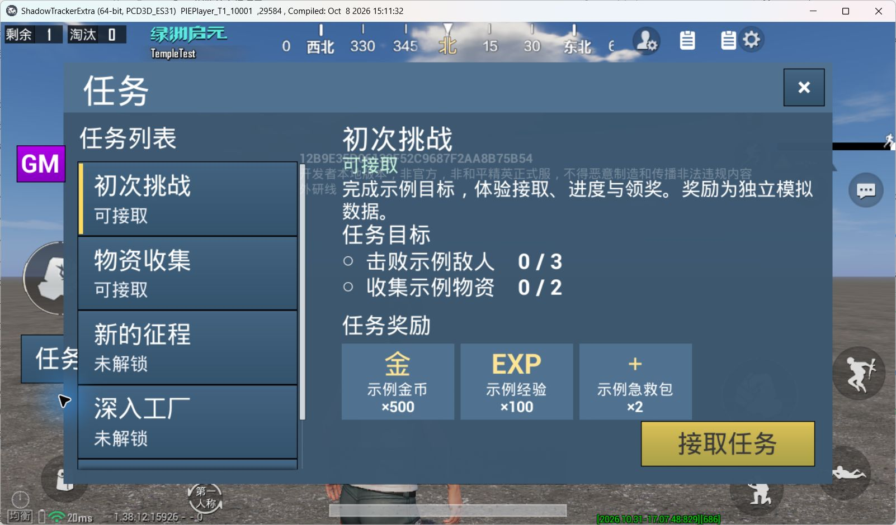

# TaskSystem 接入验收：TempleTest

2026-10-31，模板版本 0.1.0。用户确认预检方案后，通过实际 MCP 和三轮 mobile PIE 完成接入与检查；项目未上传。本文记录这一目标的证据，不代替其他工程的部署验收。

## 部署结果

- 工具模板：[framework-task](../../Templates/framework-task/README.md)，正式 12 个文件、4 个 JSON UI 定义；编辑器辅助器为 `PackageKit/editor/task_template.py`。
- 目标：`E:/WeGameApps/rail_apps/OasisEraEditor(2001776)/ShadowTrackerExtra/UGCProjects/TempleTest`，挂载根 `/TempleTest`，地图 `UGCmap`。
- 保留已有基础框架、四个实际入口、PlayerPropertyComponent 和 GM。实际 PC 在最终 return 前增加 TaskSystem 薄适配；未安装 AttributeSystem 或 SkillSystem。
- 新建 `Asset/UI/TaskSystem/UMG_TaskPanel`、`UMG_TaskRow`、`UMG_TaskReward`，编译状态均为 3，实际关联 Lua 路径存在。
- DT_UI_Config 保留原有 GM 行 1001，新增 TaskSystem 行 1010，共 2 行。生成 Package_Registry、Package_Meta_Index、Const_Data、Event_DataChange、Project_Globals 及示例命令索引/清单；保留原 Core 与测试索引。
- 正式模板默认任务仍为空；TempleTest 显式采用 Examples 的五条任务、TaskExample 包及模拟奖励 provider，不调用真实金币、经验或物品接口。
- 写入前备份：`E:/Project/ProjectCache/TempleTest-TaskSystem-20261031`，包括原 Script 与 UI 表；`deployment.json` 记录新增路径。

## 实机截图与试用



实机左侧“任务”打开面板，接取“初次挑战”。在 GM 指令页执行三次：

```text
cmd -s default -t server -TaskExample -Advance
```

每次推进一轮示例击杀、收集和区域事实。首条目标为击败 3 个示例敌人、收集 2 份示例物资，完成后手动领取模拟金币 500、经验 100、急救包 2。奖励名称与数量分行，避免截断；列表、目标和奖励可滚动。没有安装示例的正式包不登记该指令。

## 离线与编辑器检查

| 检查 | 结果 |
| --- | --- |
| Lua 5.4.8 隔离测试 | 28 项通过；使用真实模板 DataCore 与事件总线，引擎/存档为替身 |
| Python 编辑器辅助检查 | 6 项通过：工程边界、表结构/行冲突、已有控件保留等 |
| 真实 GenKit 输出 | 6 类扫描/写出检查通过，离线写出截获到内存 |
| PackageKit | 正式模板结构和模块检查通过；目标结构、依赖通过，模块检查无新增问题 |
| 哈希与解析 | 正式载荷、定义及 helper SHA-256，Lua/Python/JSON 语法和文档链接核对 |
| UI 资产与表 | 三个控件编译、Lua 绑定和六字段 UI 登记行实际读回 |

目标 GM 原有四个 `methods:...` 方法被模块检查器误报为全局；与备份基线相同，未改写 GM 消除误报。示例 Meta 的 dependsOn 只声明框架全局，TaskSystem 的本地模块依赖通过 require 表达。示例指令采用实际 GenKit 能识别的声明格式，并增加生成回归检查。

## 三轮 PIE 证据

日志根为编辑器的 `Saved/Logs/TempleTest`，client 为 `Clientlog/FullLog`，DS 为 `DSlog/FullLog`。DS 文件来自本次调试日志下载，不使用旧 session 代替结果。

| Session | 日志文件 | 已观察结果 |
| --- | --- | --- |
| `_dkfy0sqlfsba77` | `2026.10.31-16.13.16_client__dkfy0sqlfsba77_1.log`；`2026.10.31-16.13.32_ds__dkfy0sqlfsba77_realtime.log` | 默认空配置；两端任务数 0、version=1、任务状态 ready；生命周期 ready、等待 PC/Pawn 均为 0；空态显示正常 |
| `_dkfy0sqlfsbz93` | `2026.10.31-16.42.38_client__dkfy0sqlfsbz93_1.log`；`2026.10.31-16.42.51_ds__dkfy0sqlfsbz93_realtime.log` | UI 回调经真实 RPC 接取、服务端累计、客户端 OnRep 刷新；完成/领奖/解锁、重复请求及回执恢复通过 |
| `_dkfy0sqlfscapx` | `2026.10.31-17.00.29_client__dkfy0sqlfscapx_1.log`；`2026.10.31-17.00.44_ds__dkfy0sqlfscapx_realtime.log` | 最终布局和数量显示；同局原生保存/读取/恢复；选择、滚动、关闭重开、销毁重建与监听释放通过 |

可在对应日志搜索这些实际执行产生的标记（不是仅派发成功）：

- `TASK_EMPTY_CLIENT` / `TASK_EMPTY_DS`：空配置、数据及生命周期就绪。
- `TASK_ACCEPT_CONFIRMED`：active，真实结果事件 1 次、复制通知 1 次；同一列表行实例保留。
- `TASK_PROGRESS_CONFIRMED`：completed，击杀 3/3、收集 2/2，UI 操作变为领取奖励；GM 指令经服务端推进。
- `TASK_CLAIM_CONFIRMED`：claimed，模拟余额 500/100/2；前置任务领奖后解锁后续。
- `TASK_REPEAT_CONFIRMED`：重复领奖返回 already-claimed，余额不变；客户端 progress 请求被拒绝。
- `TASK_DS_RUNTIME`：事件去重、目标筛选、上限、空奖励与已发奖回执恢复；回执 1 份，余额不变。
- `TASK_NATIVE_ARCHIVE_RESTORE PASSED`：同局原生存档读回后，分离运行字段并通过 RestoreArchiveData 恢复 active、kill=1、version=1，存档大小 226 字节。
- `TASK_UI_FINAL` / `TASK_UI_RECREATE` / `TASK_UI_NATIVE_CLEANUP`：选择、无奖励、滚动、开关、数量及恢复后复制；新实例 5 行、3 个按钮绑定，changed/result 监听各 1 个。

UI 操作通过实际控件绑定的 Lua 回调和真实 RPC 检查。桌面自动输入没有触发原有 GM 与任务按钮；用户手动确认关闭按钮正常，未将自动输入故障当作产品问题，也未把所有物理触屏操作记为自动测试通过。

## 调试中修正与边界

新建 WidgetTree 的 AllWidgets 是编译缓存，不能用于立即取新增控件；builder 改为按本树精确路径加载。恢复只处理本次已检查的未保存资产；默认保留已有匹配资产，结构冲突停止。FMargin 使用具名格式，字体原位修改并实际读回；目标区和奖励区按较矮横屏调整。

第一版同局恢复探针使用 ModifyPackage 清空运行表，连带改变了 PIE 返回的同引用存档缓存，断言失败；改为先分离运行字段后再恢复，最终通过。原生销毁后旧 userdata 不可再索引，清理检查改为验证当前事件监听和控件数，最终通过。这些是探针修正，未修改通用 Core 以迎合测试。

引擎本地接口说明 `Content/LuaHelper/Source/Lua/ugc/UGCAPI/UGCPlayerStateSystem.lua` 第 37、44、52、58 行明确：PIE 无法跨对局保存和读取存档。第三轮确实从新数据开始；不能声称发布环境跨局存档已验证。发布后仍需验证同账号跨局恢复及项目真实奖励提供者的持久化去重、异步失败/部分发放恢复。正式包只提供 Validate / Query / Grant 契约，不保证多个原生奖励接口具有事务性。

全部实机检查结束后停止 PIE，临时监听与测试引用已清理，未向项目写入临时探针或修改测试套件。示例配置与正式接入保留，供后续试用。
